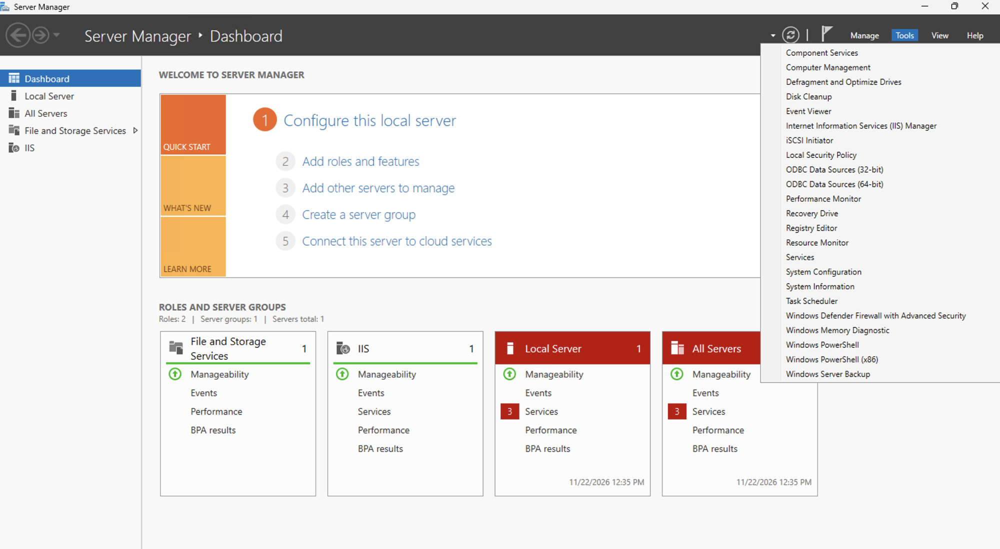
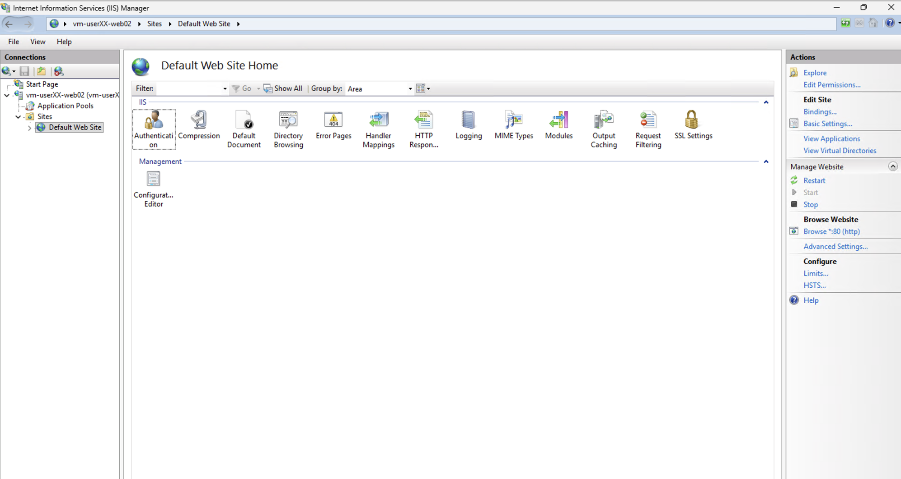

<br>

# Azure 勉強会手順書

Azureの基本を学ぶための実習手順です。

- **受信通信:** Public Load Balancer が 2 台の VM に HTTP 通信を分散
- **送信通信:** Route Table の UDR により、Web サブネットからの通信を Azure Firewall へ転送

---

<br>

## 目次

1. [Azure ユーザーアカウント](#1-azure-ユーザーアカウント)
2. [完成構成](#2-完成構成)
3. [作成リソース](#3-作成リソース)
4. [リソースグループの作成](#4-リソースグループの作成)
5. [VNet とサブネットの作成](#5-vnet-とサブネットの作成)
6. [NSG の作成](#6-nsg-の作成)
7. [VM の作成](#7-vm-の作成)
8. [IIS の構築](#8-iis-の構築)
9. [Public Load Balancer の作成](#9-public-load-balancer-の作成)
10. [正常性プローブと負荷分散規則](#10-正常性プローブと負荷分散規則)
11. [Firewall Policy の作成](#11-firewall-policy-の作成)
12. [Azure Firewall の作成](#12-azure-firewall-の作成)
13. [ルートテーブルの作成](#13-ルートテーブルの作成)
14. [Firewall 許可ルールの作成](#14-firewall-許可ルールの作成)
15. [動作確認](#15-動作確認)
16. [トラブルシューティング](#16-トラブルシューティング)

---

<br>

# 1. Azure ユーザーアカウント

| 名前 | ユーザーアカウント | パスワード |
|---|---|---|
| 社員A | `user01` | |
| 社員B | `user02` | |
| 社員C | `user03` | |
| 社員D | `user04` | |
| 社員E | `user05` | |
| 社員F | `user06` | |

---

<br>

# 2. 完成構成

<br>

## 受信通信

```text
Internet
   │ HTTP :80
   ▼
Public Load Balancer
   │
   ├─────────── vm-userXX-web01
   └─────────── vm-userXX-web02
```

<br>

## 送信通信

```text
vm-userXX-Test01
        │
        ▼
WebSubnet に関連付けたルートテーブル
        │ 0.0.0.0/0
        ▼
Azure Firewall
        │
        ▼
Internet
```

<br>

## 各コンポーネントの役割

| コンポーネント | 役割 |
|---|---|
| Public Load Balancer | インターネットからの HTTP 通信を 2 台の VM に分散 |
| NSG | Web サブネットへの通信を制御 |
| Route Table | VM からインターネットへの通信を Azure Firewall に転送 |
| Azure Firewall | VM の外向き通信を許可または拒否 |
| VM | IIS を稼働し、Load Balancer の振り分け先として使用 |

---

<br>

# 3. 作成リソース

| 種類 | 名前 | 主な設定 |
|---|---|---|
| Resource Group | `rg-userXX-study` | Japan East |
| VNet | `vnet-userXX-study` | `10.0.0.0/16` |
| Web サブネット | `WebSubnet` | `10.0.1.0/24` |
| Test サブネット | `TestSubnet` | `10.0.2.0/24` |
| Firewall サブネット | `AzureFirewallSubnet` | `10.0.3.0/26` |
| NSG | `nsg-web` | TCP / 80 を許可 |
| VM | `vm-userXX-web01` | Windows Server 2025 |
| VM | `vm-userXX-web02` | Windows Server 2025 |
| VM | `vm-userXX-test01` | Windows Server 2025 |
| Load Balancer | `lb-web` | Standard / Public |
| LB Public IP | `pip-lb` | Standard / 静的 |
| Firewall Policy | `fw-policy-study` | Standard |
| Azure Firewall | `azfw-study` | Standard |
| Firewall Public IP | `pip-firewall` | Standard / 静的 |
| Route Table | `rt-web` | `0.0.0.0/0` → Firewall |

> [!IMPORTANT]
> `AzureFirewallSubnet` は Azure Firewall 専用のサブネット名です。Microsoft の現行チュートリアルでは最小 `/26` が案内されているため、今回は `10.0.3.0/26` を使用します。

---

<br>

# 4. リソースグループの作成

1. Azure Portal にサインインします。
2. 上部の検索欄へ「リソース グループ」と入力します。
3. 検索結果の **リソース グループ** を選択します。
4. **＋ 作成** を選択します。
5. **基本** タブで次を入力します。

| 項目 | 設定値 |
|---|---|
| サブスクリプション | 勉強会で使用するサブスクリプション |
| リソースグループ | `rg-userXX-study`<br>userXXは、各ユーザーのユーザ名を入れてください |
| リージョン | `Japan East` |

6. **レビューと作成** を選択します。
7. 「検証に成功しました」と表示されたら **作成** を選択します。

---

<br>

# 5. VNet とサブネットの作成

画面名は Azure Portal の更新により変わる場合がありますが、基本的な操作は同じです。

<br>

## 5.1 VNet の基本設定

1. 検索欄で「仮想ネットワーク」を検索し、**仮想ネットワーク**を選択します。
2. **＋ 作成** を選択します。
3. **基本** タブで次を設定します。

| 項目 | 設定値 |
|---|---|
| サブスクリプション | 使用するサブスクリプション |
| リソースグループ | `rg-userXX-study` |
| 仮想ネットワーク名 | `vnet-userXX-study` |
| リージョン | `Japan East` |

4. **次へ: セキュリティ**を選択します。
5. 不要な追加機能は有効にせず、**次へ**を選択します。

<br>

## 5.2 アドレス空間

| 項目 | 設定値 |
|---|---|
| IPv4 アドレス空間 | `10.0.0.0/16` |

既定のアドレス空間が異なる場合は削除または編集します。

<br>

## 5.3 WebSubnet の作成

既定サブネットがある場合は、そのサブネットを編集します。

| 項目 | 設定値 |
|---|---|
| サブネットの目的 | 既定 |
| 名前 | `WebSubnet` |
| 開始アドレス | `10.0.1.0` |
| サイズ | `/24` |
| NAT Gateway | なし |
| NSG | なし |
| Route Table | なし |
| サービスエンドポイント | なし |

**保存**または**追加**を選択します。

<br>

## 5.4 TestSubnet の作成

**＋ サブネットの追加**を選択し、次を設定します。

| 項目 | 設定値 |
|---|---|
| サブネットの目的 | 既定 |
| 名前 | `TestSubnet` |
| 開始アドレス | `10.0.2.0` |
| サイズ | `/24` |
| NAT Gateway | なし |
| NSG | なし |
| Route Table | なし |
| サービスエンドポイント | なし |

**保存**または**追加**を選択します。

<br>

## 5.5 AzureFirewallSubnet の作成

**＋ サブネットの追加**を選択し、次を設定します。

| 項目 | 設定値 |
|---|---|
| サブネットの目的 | Azure Firewall |
| 名前 | `AzureFirewallSubnet` |
| 開始アドレス | `10.0.3.0` |
| サイズ | `/26` |
| NAT Gateway | なし |
| NSG | なし |
| Route Table | なし |

サブネットの目的で **Azure Firewall** を選択すると、名前が自動的に `AzureFirewallSubnet` になる場合があります。

> [!NOTE]
> Azure Firewall 用サブネットには、`nsg-web` や `rt-web` を関連付けません。

<br>

## 5.6 VNet の作成

1. **レビューと作成**を選択します。
2. 表示内容を確認します。
3. 検証に成功したら **作成** を選択します。

---

<br>

# 6. NSG の作成

NSG をサブネットへ関連付けると、サブネットに配置されたリソースへルールが適用されます。

<br>

## 6.1 NSG 本体の作成

1. 検索欄で「ネットワーク セキュリティ グループ」を検索します。
2. **＋ 作成**を選択します。
3. 次を設定します。

| 項目 | 設定値 |
|---|---|
| サブスクリプション | 使用するサブスクリプション |
| リソースグループ | `rg-userXX-study` |
| 名前 | `nsg-web` |
| リージョン | `Japan East` |

4. **確認および作成**→**作成**を選択します。
5. デプロイ完了後、**リソースに移動**を選択します。

<br>

## 6.2 RDP 受信規則の作成

1. `nsg-web` の **設定**→**受信セキュリティ規則**を選択します。
2. **＋ 追加**を選択します。
3. 次を設定します。

| 項目 | 設定値 |
|---|---|
| ソース | `Any` |
| ソース ポート範囲 | `*` |
| 宛先 | `Any` |
| サービス | RDP |
| 宛先ポート範囲 | `3389` |
| プロトコル | TCP |
| アクション | 許可 |
| 優先度 | `200` |
| 名前 | `Allow-RDP-Any` |

4. **追加**を選択します。

<br>

## 6.3 HTTP 受信規則の作成

1. `nsg-web` の **設定**→**受信セキュリティ規則**を選択します。
2. **＋ 追加**を選択します。
3. 次を設定します。

| 項目 | 設定値 |
|---|---|
| ソース | サービス タグ |
| ソース サービス タグ | `AzureLoadBalancer` |
| ソース ポート範囲 | `*` |
| 宛先 | `Any` |
| サービス | HTTP |
| 宛先ポート範囲 | `80` |
| プロトコル | TCP |
| アクション | 許可 |
| 優先度 | `300` |
| 名前 | `Allow-HTTP-From-LoadBalancer` |

4. **追加**を選択します。


ロードバランサーの正常性プローブには既定規則 `AllowAzureLoadBalancerInBound` が使用されます。独自の拒否ルールを追加する場合は、正常性プローブまで拒否しないよう注意してください。

<br>

## 6.3 WebSubnet への関連付け

1. `nsg-web` の **設定**→**サブネット**を選択します。
2. **＋ 関連付け**を選択します。
3. 次を設定します。

| 項目 | 設定値 |
|---|---|
| 仮想ネットワーク | `vnet-userXX-study` |
| サブネット | `WebSubnet` |

4. **OK**を選択します。

---

<br>

# 7. VM の作成

<br>

## 7.1 vm-userXX-web01 の作成

1. 検索欄で「仮想マシン」を検索し、**仮想マシン**を選択します。
2. **＋ 作成**→**Azure 仮想マシン**を選択します。

### 基本設定

| 項目 | 設定値 |
|---|---|
| サブスクリプション | 使用するサブスクリプション |
| リソースグループ | `rg-userXX-study` |
| 仮想マシン名 | `vm-userXX-web01`<br>*※userXXには、各ユーザーのユーザ名を入れてください* |
| リージョン | `Japan East` |
| 可用性オプション | インフラストラクチャ冗長は不要 |
| セキュリティの種類 | 標準 |
| イメージ | [smalldisk] Windows Server 2025 Datacenter: Azure Edition <br>*※See all images からWindows Server を選択し、表示された一覧から選択してください*|
| VM アーキテクチャ | x64 |
| Spot 割引 | 使用しない |
| サイズ | `Standard_B2ms` または利用可能な小型サイズ |
| ユーザー名 | 任意の管理者名 |
| パスワード | Azure の複雑性要件を満たすパスワード |

>パスワード要件
>- 8文字以上、123文字以下
>- 次の4種類のうち、3種類以上を含む
>- 英大文字 A-Z
>- 英小文字 a-z
>- 数字 0-9
>- 特殊文字 _を含む記号


### 受信ポート

| 項目 | 設定値 |
|---|---|
| パブリック受信ポート | 選択したポートを許可する |
|受信ポートの選択|RDP (3389)|


### ディスク設定

| 項目 | 設定値 |
|---|---|
| OS ディスクの種類 | Standard SSD |
| VM と共に削除 | 有効 |

### ネットワーク設定

| 項目 | 設定値 |
|---|---|
| 仮想ネットワーク | `vnet-userXX-study` |
| サブネット | `WebSubnet` |
| パブリック IP | 新規作成 |
| NIC NSG | なし |
| VMが削除されたときにNICを削除する|チェック|
| 高速ネットワーク | 既定値 |
| ロードバランサーの背後に配置 | いいえ |

NSG は WebSubnet に関連付けているため、NIC 側では作成しません。

### vm-web01用Public IPの作成

**［パブリック IP］欄の［新規作成］** を選択します。次の値を設定します。


| 項目 | 設定値 |
|---|---|
| 名前 | `pip-vm-userXX-web01` |
| SKU | `Standard` |
| IP バージョン | `IPv4` |
| 割り当て | `静的` |
| 可用性ゾーン | `ゾーンがありません` |

**［OK］** を選択します。

### 管理設定

| 項目 | 設定値 |
|---|---|
| 自動シャットダウン | 有効推奨 |
| シャットダウン時刻 | 勉強会終了後の時刻 |
| タイムゾーン | Tokyo Standard Time |

**確認および作成**→**作成**を選択します。

<br>

## 7.2 vm-userXX-web02 の作成

`vm-userXX-web01` と同じ操作で次を設定します。

| 項目 | 設定値 |
|---|---|
| 仮想マシン名 | `vm-userXX-web02`<br>*※userXXには、各ユーザーのユーザ名を入れてください* |
| VNet | `vnet-userXX-study` |
| サブネット | `WebSubnet` |
| パブリック IP | なし |
| NIC NSG | なし |

<br>

## 7.3 vm-userXX-test01 の作成

`vm-userXX-web01` と同じ操作で次を設定します。

| 項目 | 設定値 |
|---|---|
| 仮想マシン名 | `vm-userXX-test01`<br>*※userXXには、各ユーザーのユーザ名を入れてください* |
| VNet | `vnet-userXX-study` |
| サブネット | `TestSubnet` |
| パブリック IP | 新規作成 |
| NIC NSG | なし |

**［パブリック IP］欄の［新規作成］** を選択し、次を設定します。

| 項目 | 設定値 |
|---|---|
| 名前 | `pip-vm-userXX-test01` |
| SKU | `Standard` |
| IP バージョン | `IPv4` |
| 割り当て | `静的` |
| 可用性ゾーン | `ゾーンがありません` |

**［OK］** を選択し、管理設定以外のパラメーターは `vm-userXX-web01` と同じ値を設定します。最後に**確認および作成**→**作成**を選択します。

---

<br>

# 8. IIS の構築

<br>

## 8.1 vm-userXX-web01 の設定

1. Portalで `vm-userXX-web01` を開きます。
<br>*※userXXには、各ユーザーのユーザ名を入れてください*
2. **操作**→**実行コマンド**を選択します。
3. **RunPowerShellScript**を選択します。
4. 次を実行します。

```powershell
Install-WindowsFeature -Name Web-Server -IncludeManagementTools

@"
<!DOCTYPE html>
<html lang="ja">
<head>
    <meta charset="utf-8">
    <title>Azure Network Study</title>
</head>
<body>
    <h1>WEB01</h1>
    <p>Response from vm-userXX-web01</p>
</body>
</html>
"@ | Set-Content `
    -Path "C:\inetpub\wwwroot\index.html" `
    -Encoding UTF8
```

完了メッセージが表示されるまで待ちます。

<br>

## 8.2 vm-userXX-web02 の設定

`vm-userXX-web02` の実行コマンドで、IIS と次の HTML を設定します。

```powershell
Install-WindowsFeature -Name Web-Server -IncludeManagementTools

@"
<!DOCTYPE html>
<html lang="ja">
<head>
    <meta charset="utf-8">
    <title>Azure Network Study</title>
</head>
<body>
    <h1>WEB02</h1>
    <p>Response from vm-userXX-web02</p>
</body>
</html>
"@ | Set-Content `
    -Path "C:\inetpub\wwwroot\index.html" `
    -Encoding UTF8
```

完了メッセージが表示されるまで待ちます。

<br>

## 8.3 VMにリモート接続し、IISでWebページの表示を確認

1. 各VMに付与されたパブリックIPアドレスを確認し、リモートデスクトップ接続します。

2. Tool → Internet Information Service　を開きます。



3. Browse*:80 (http) を選択し、設定したwebページが表示されることを確認します。




---

<br>

# 9. Public Load Balancer の作成

Azure Portal の現行手順では、次の順序で構成します。

1. ロードバランサー本体
2. フロントエンド IP
3. バックエンドプール
4. 正常性プローブ
5. 負荷分散規則

<br>

## 9.1 Load Balancer 本体

1. 検索欄で「ロード バランサー」を検索し、**ロード バランサー**を選択します。
2. **＋ 作成**を選択します。
3. **Standard Load Balancer** を選択します。

| 項目 | 設定値 |
|---|---|
| サブスクリプション | 使用するサブスクリプション |
| リソースグループ | `rg-userXX-study` |
| 名前 | `lb-web` |
| リージョン | `Japan East` |
| SKU | Standard |
| 種類 | パブリック |
| レベル | 地域 |

**次へ: フロントエンド IP 構成**を選択します。

<br>

## 9.2 フロントエンド IP

1. **＋ フロントエンド IP 構成の追加**を選択します。
2. 次を設定します。

| 項目 | 設定値 |
|---|---|
| 名前 | `fe-web` |
| IP バージョン | IPv4 |
| IP の種類 | IP アドレス |
| パブリック IP アドレス | 新規作成 |

パブリック IP の作成画面で次を設定します。

| 項目 | 設定値 |
|---|---|
| 名前 | `pip-lb` |
| SKU | Standard |
| 割り当て | 静的 |
| 可用性ゾーン | ゾーンなし |

**保存**、続いてフロントエンド IP の画面で **保存**を選択します。

<br>

## 9.3 バックエンドプール

1. **バックエンドプール**タブへ移動します。
2. **＋ バックエンドプールの追加**を選択します。
3. 次を設定します。

| 項目 | 設定値 |
|---|---|
| 名前 | `backend-web` |
| 仮想ネットワーク | `vnet-userXX-study` |
| バックエンドプールの構成 | NIC |

4. **仮想マシンの追加**を選択します。
5. `vm-userXX-web01` と `vm-userXX-web02` を選択し、**追加**を選択します。
6. **保存**を選択します。
7. **確認および作成**→**作成**を選択します。

---

<br>

# 10. 正常性プローブと負荷分散規則

<br>

## 10.1 正常性プローブの作成

1. `lb-web` の **設定**→**正常性プローブ**を選択します。
2. **＋ 追加**を選択します。

| 項目 | 設定値 |
|---|---|
| 名前 | `probe-http` |
| プロトコル | HTTP |
| ポート | `80` |
| パス | `/` |
| 間隔 | `5` 秒 |

**保存**を選択します。

> [!NOTE] 
> 正常性プローブは IIS の `/` に HTTP 接続し、VM が応答可能かを確認します。

<br>

## 10.2 負荷分散規則の作成

1. **設定**→**負荷分散規則**を選択します。
2. **＋ 追加**を選択します。

| 項目 | 設定値 |
|---|---|
| 名前 | `rule-http` |
| IP バージョン | IPv4 |
| フロントエンド IP アドレス | `fe-web` |
| バックエンドプール | `backend-web` |
| プロトコル | TCP |
| フロントエンドポート | `80` |
| バックエンドポート | `80` |
| 正常性プローブ | `probe-http` |
| セッション永続化 | なし |
| 会うドルタイムアウト | 4分 |
| TCPリセットの有効化 | 無効 |
| フローティング IP | 無効 |

**保存**を選択します。

---

<br>

# 11. Firewall Policy の作成

1. 検索欄で「firewall policies」を検索します。
2. **＋ 作成**を選択します。
3. 次を設定します。

| 項目 | 設定値 |
|---|---|
| サブスクリプション | 使用するサブスクリプション |
| リソースグループ | `rg-userXX-study` |
| 名前 | `fw-policy-study` |
| リージョン | `Japan East` |
| ポリシー層 | Standard |
| 親ポリシー | なし |


4. **確認および作成**→**作成**を選択します。

---

<br>

# 12. Azure Firewall の作成

Azure Firewall は、専用サブネット、Firewall Policy、パブリック IP を指定してデプロイします。

<br>

## 12.1 基本設定

1. 検索欄で「firewall」を検索します。
2. **＋ 作成**を選択します。

| 項目 | 設定値 |
|---|---|
| サブスクリプション | 使用するサブスクリプション |
| リソースグループ | `rg-userXX-study` |
| 名前 | `azfw-study` |
| リージョン | `Japan East` |
| Firewall SKU | Standard |
| Firewall 管理 | Firewall Policy を使用 |
| Firewall Policy | `fw-policy-study` |
| 仮想ネットワーク | 既存の `vnet-userXX-study` |
| ファイアウォール管理NIC | 無効 |

<br>

## 12.2 パブリック IP

1. パブリック IP 欄で **新規追加**を選択し、次を設定します。

| 項目 | 設定値 |
|---|---|
| 名前 | `pip-firewall` |
| SKU | Standard |
| 割り当て | 静的 |

2. **OK**→**次：詳細** を選択します。

<br>

## 12.3 詳細設定

| 項目 | 設定値 |
|---|---|
| NAT Gateway | 無効 |

1. **次へ**→**次：確認および作成**→**作成**を選択します。


> [!NOTE]
> Azure Firewall のデプロイには、VM や NSG よりも長い時間がかかります。

<br>

## 12.4 プライベート IP の確認

1. デプロイ完了後、`azfw-study` を開き、**概要**から **ファイアウォールのプライベート IP** を確認します。

```text
例: 10.0.2.4
```

実際の値は環境によって異なるため、固定値として扱わないでください。

---

<br>

# 13. ルートテーブルの作成

Azure の既定ルートを上書きするには、ユーザー定義ルート（UDR）を使用します。

<br>

## 13.1 Route Table 本体

1. 検索欄で「ルート テーブル」を検索します。
2. **＋ 作成**を選択します。

| 項目 | 設定値 |
|---|---|
| サブスクリプション | 使用するサブスクリプション |
| リソースグループ | `rg-userXX-study` |
| リージョン | `Japan East` |
| 名前 | `rt-web` |
| ゲートウェイルートの伝達 | いいえ |

3. **確認および作成**→**作成**を選択します。

<br>

## 13.2 既定ルートの追加

1. `rt-web` の **設定**→**ルート**から **＋ 追加**を選択し、次を設定します。

| 項目 | 設定値 |
|---|---|
| ルート名 | `default-to-firewall` |
| 宛先の種類 | IP アドレス |
| 宛先 IP アドレス/CIDR 範囲 | `0.0.0.0/0` |
| 次ホップの種類 | 仮想アプライアンス |
| 次ホップアドレス | Azure Firewall のプライベート IP |

```text
例: 10.0.2.4
```

2. **追加**を選択します。

<br>

## 13.3 TestSubnet への関連付け

1. `rt-web` の **設定**→**サブネット**を選択します。
2. **＋ 関連付け**を選択します。

| 項目 | 設定値 |
|---|---|
| 仮想ネットワーク | `vnet-userXX-study` |
| サブネット | `TestSubnet` |

3. **OK**を選択します。

> [!WARNING]
> `rt-web` は `TestSubnet` にだけ関連付けます。`AzureFirewallSubnet`, `WebSubnet`には関連付けません。

---

<br>

# 14. Firewall 許可ルールの作成

Azure Firewall Policy では次の 2 種類のルールを作成できます。

- **アプリケーションルール:** FQDN と HTTPS を指定して通信を許可
- **ネットワークルール:** IP アドレス、プロトコル、ポートを指定して通信を許可

<br>

## 14.1 アプリケーションルールコレクション の作成

1. `fw-policy-study` を開きます。
2. **Rules**→**アプリケーション規則**を選択します。
3. **＋ 規則コレクションの追加**を選択します。

| 項目 | 設定値 |
|---|---|
| 名前 | `Allow-Web-FQDN` |
| 規則コレクションの種類 | `アプリケーション` |
| 優先度 | `100` |
| アクション | 許可 |
| グループ | 規定値 |


ルールは次のとおりです。

| 項目 | 設定値 |
|---|---|
| ルール名 | `Allow-Microsoft` |
| ソースの種類 | IP アドレス |
| ソース | `10.0.1.0/24` |
| プロトコル | HTTPS |
| ポート | `443` |
| 宛先の種類 | FQDN |
| 宛先 | `www.microsoft.com` |

4. **追加** を選択します。

---

<br>

# 15. 動作確認

<br>

## 15.1 Load Balancer の確認

1. `lb-web` の **概要**を開きます。
2. フロントエンド IP またはパブリック IP をコピーします。
3. ブラウザーから次へアクセスします。

```text
http://<Load Balancer のパブリック IP>
```

例:

```text
http://20.xxx.xxx.xxx
```

`WEB01` または `WEB02` が表示されれば成功です。

<br>

## 15.2 負荷分散の確認

ブラウザーの更新だけでは、同じ VM が表示され続ける場合があります。

1. ローカル PC の PowerShell で次を実行します。

```powershell
1..20 | ForEach-Object {
    (Invoke-WebRequest `
        -Uri "http://<Load Balancer のパブリック IP>" `
        -UseBasicParsing
    ).Content
}
```

`WEB01` と `WEB02` の両方が確認できれば、負荷分散は正常です。

> [!NOTE]
> Load Balancer はフローに基づいて分散するため、更新のたびに必ず交互に表示されるとは限りません。

<br>

## 15.3 許可したサイトへの通信

1. `vm-userXX-web01` を開きます。
2. **操作**→**実行コマンド**→**RunPowerShellScript**を選択します。
3. 次を実行します。

```powershell
Invoke-WebRequest `
    -Uri "https://www.microsoft.com" `
    -UseBasicParsing |
    Select-Object StatusCode
```

```text
StatusCode
----------
200
```

リダイレクトなどにより、200以外の正常系コードになる場合があります。

<br>

## 15.4 許可していないサイトへの通信

許可していない FQDN にアクセスします。

```powershell
Invoke-WebRequest `
    -Uri "https://example.com" `
    -UseBasicParsing
```

`example.com` を許可していなければ、通信失敗を確認できます。

<br>

## 15.5 Firewall ルール変更後の再確認

1. `fw-policy-study` を開きます。
2. `rcg-web` 内のアプリケーションルールに次を追加します。

| 項目 | 設定値 |
|---|---|
| ルール名 | `Allow-Example` |
| ソース | `10.0.1.0/24` |
| プロトコル | HTTPS |
| ポート | `443` |
| 宛先 | `example.com` |

3. 数分待ってから VM の実行コマンドで再テストします。

```powershell
Invoke-WebRequest `
    -Uri "https://example.com" `
    -UseBasicParsing |
    Select-Object StatusCode
```

成功すれば、Azure Firewall が許可リストとして動作していることを確認できます。

---

<br>

# 16. トラブルシューティング

<br>

## 16.1 Load Balancer の画面が表示されない

### 1. バックエンド正常性

`lb-web`→**設定**→**負荷分散規則**→**詳細の表示**から、次を確認します。

- `vm-userXX-web01`
- `vm-userXX-web02`

両方が「正常」になっているか確認します。

### 2. IIS の状態

各 VM の実行コマンドで確認します。

```powershell
Get-Service W3SVC
```

停止している場合は次を実行します。

```powershell
Start-Service W3SVC
```

### 3. ポート 80 の待ち受け

```powershell
Get-NetTCPConnection -LocalPort 80 -State Listen
```

### 4. ローカル IIS の確認

```powershell
Invoke-WebRequest `
    -Uri "http://localhost" `
    -UseBasicParsing
```

### 5. NSG の確認

`nsg-web` に TCP / 80 の許可規則があるか確認します。

### 6. バックエンドプールの確認

`backend-web` に次の VM が登録されているか確認します。

- `vm-userXX-web01`
- `vm-userXX-web02`

### 7. 正常性プローブの確認

| 項目 | 設定値 |
|---|---|
| プロトコル | HTTP |
| ポート | `80` |
| パス | `/` |

<br>

## 16.2 外部通信できない

### 1. 有効なルートの確認

`vm-userXX-web01`→**ネットワーク**→**ネットワークインターフェイス**→**有効なルート**で確認します。

| 項目 | 確認値 |
|---|---|
| 宛先 | `0.0.0.0/0` |
| 次ホップの種類 | `VirtualAppliance` |
| 次ホップ IP | Azure Firewall のプライベート IP |

### 2. Route Table の関連付け

`rt-web` が `WebSubnet` に関連付けられているか確認します。

### 3. 次ホップ IP

ルートに入力した IP が、パブリック IPではなくプライベート IPであることを確認します。

### 4. Firewall Policy

`azfw-study` に `fw-policy-study` が関連付けられているか確認します。

### 5. DNS ルール

FQDN を使用する場合は DNS 名前解決を確認します。

```powershell
Resolve-DnsName www.microsoft.com
```

---
